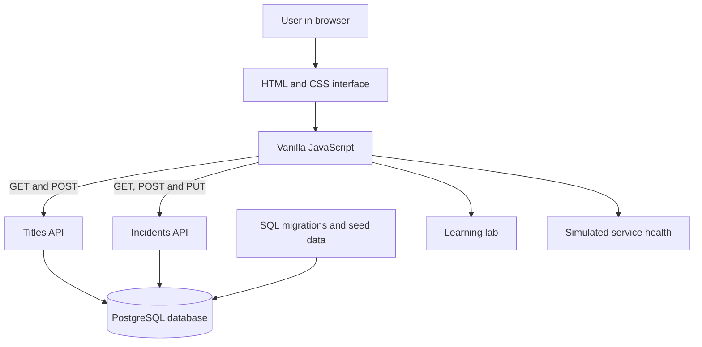

# StreamOps — Streaming Engineering Console

StreamOps is a portfolio learning project inspired by internal tools used to manage content records, track incidents, and understand service reliability.

> **Learning/demo project:** titles and incidents are fictional. Availability, latency, error rates, charts, and dashboard trends are illustrative values—not live telemetry from a real streaming platform.

## Features

- **Content catalogue:** list, search, and filter fictional titles; add titles with validated fields.
- **Incident tracker:** search/filter incidents, create incidents, and move them through Open → Investigating → Resolved.
- **Service health:** explore sample availability, p95 latency, and error-rate indicators.
- **Learning lab:** explanations, diagrams, code snippets, and quick checks for architecture, APIs, databases, incident lifecycles, and testing.
- **PostgreSQL persistence:** schema migrations and sample records for titles and incidents.

## Technology

- HTML and CSS
- Vanilla JavaScript for rendering, filtering, forms, and HTTP requests
- PostgreSQL
- Hatchable-hosted API handlers using the platform-provided `db` client from `hatchable`

## Architecture



The browser renders the interface and sends requests to API handlers. The handlers validate incoming data and use parameterized SQL queries to read or update PostgreSQL. The service-health panel is educational sample content and does not monitor a production system.

## Project structure

```text
streamops/
├── public/
│   ├── index.html
│   ├── styles.css
│   └── app.js
├── api/
│   ├── titles.js
│   ├── incidents.js
│   └── incidents/
│       └── [id].js
├── lib/
│   └── validation.js
├── tests/
│   └── validation.test.mjs
├── migrations/
│   ├── 001_titles.sql
│   └── 002_incidents.sql
├── seed.sql
└── README.md
```

## API overview

| Method | Route | Purpose |
|---|---|---|
| GET | `/titles` | List catalogue titles |
| POST | `/titles` | Validate and create a title |
| GET | `/incidents` | List incidents, prioritizing unresolved/high-severity records |
| POST | `/incidents` | Validate and create an incident |
| PUT | `/incidents/:id` | Update an incident status |

The API validates required fields and allowed values. Database writes use parameterized queries. The incident update endpoint returns 404 if the requested incident does not exist.

## Automated validation tests

The shared validation rules used by the API handlers have repeatable tests in `tests/validation.test.mjs`. They cover valid inputs, defaults, whitespace trimming, missing required fields, unsupported values, maximum lengths, and incident status updates.

These are **unit tests for validation logic**. They complement—but do not replace—the live API/database checks for HTTP status codes, persistence, and not-found behavior.

Requirements: Node.js 20+ (Node.js 22 recommended). From the repository root, run:

```bash
node --experimental-default-type=module --test tests/validation.test.mjs
```

The flag lets Node load the shared `.js` file as an ES module without changing Hatchable's project configuration. A successful run prints a summary showing the number of passing tests.

## Database

- `titles`: title, type, genre, region, availability, release date, and creation timestamp.
- `incidents`: title, affected service, severity, status, description, reported timestamp, and updated timestamp.

Apply the SQL files in `migrations/` in numerical order, then run `seed.sql` to insert fictional starter records. The seed script is intended for a fresh/demo database; running it repeatedly may create duplicate sample records.

## Run and deployment notes

The current frontend and API handlers target **Hatchable**. Because the API code imports `db` from `hatchable`, it is **not a standalone Node.js backend** and cannot run unchanged in a generic local Node server.

1. Open the [StreamOps Hatchable project](https://hatchable.com/console/projects/streamops-streaming-y8c2).
2. Use the configured Hatchable runtime and PostgreSQL database for the hosted version.
3. Apply the migrations and seed data in that environment if needed.
4. To run outside Hatchable, adapt the API layer and database configuration to a conventional Node.js server and PostgreSQL client. This is a future improvement, not a capability claimed by the repository yet.

The hosted preview URL may require access or change as the project evolves.

## Learning roadmap

- [x] Add automated validation tests for valid and invalid title/incident inputs.
- [ ] Add consistent server-side error handling and structured logs.
- [ ] Add pagination and stronger search/filter behavior.
- [ ] Create a conventional local-development setup independent of Hatchable.
- [ ] Connect a real telemetry source or keep all service-health values labelled as mock data.
- [ ] Check accessibility and keyboard interactions.
- [ ] Add current screenshots of the working interface.

## Why I built it

This project helps me learn how frontend screens, REST-style API routes, validation, SQL persistence, and operational workflows fit together. It is inspired by streaming-platform engineering concepts, but it is an independent educational project and is not affiliated with or endorsed by Netflix or another streaming company.
