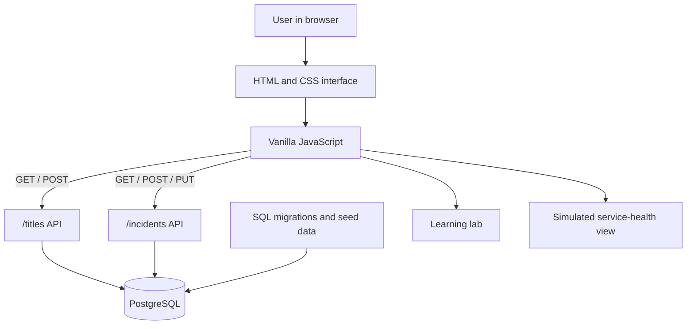

# StreamOps — Streaming Engineering Console

StreamOps is a portfolio learning project inspired by the kinds of internal tools engineering teams use to manage content records, track incidents, and reason about service reliability.

> **Learning/demo project:** all titles and incidents are fictional. Service-health percentages, latency, error rates, charts, and dashboard trends are illustrative sample values, not live telemetry from a real streaming platform.

## What it does

- **Content catalogue:** list, search, and filter fictional titles; add a title with validated fields.
- **Incident tracker:** list and filter incidents by status and severity; create incidents; move incidents through Open → Investigating → Resolved.
- **Service health:** explore example availability, p95 latency, and error-rate indicators.
- **Learning lab:** beginner-friendly explanations, flow diagrams, code snippets, and quick checks for architecture, APIs, databases, incident lifecycles, and testing.
- **PostgreSQL persistence:** schema migrations and seed records for titles and incidents.

## Technology

- HTML for page structure
- CSS for responsive styling and dashboard layout
- Vanilla JavaScript for UI state, rendering, forms, filtering, and HTTP requests
- PostgreSQL for persistent records
- Hatchable-hosted API handlers (the backend imports the platform-provided `db` client from `hatchable`)

## Architecture



The browser renders the screens and sends requests to the API. The API validates incoming data and uses parameterized SQL queries to read or update PostgreSQL. The service-health panel is currently educational/demo content; it does not connect to production monitoring systems.

## Project structure

```text
streamops/
├── public/
│   ├── index.html
│   ├── styles.css
│   └── app.js
├── api/
│   ├── titles.js
│   └── incidents.js
│   └── incidents/
│       └── [id].js
├── migrations/
│   ├── 001_titles.sql
│   └── 002_incidents.sql
├── seed.sql
└── README.md
```

## API overview

| Method | Route | Purpose |
|---|---|---|
| GET | `/titles` | List catalogue titles |
| POST | `/titles` | Validate and create a title |
| GET | `/incidents` | List incidents, prioritizing unresolved/high-severity records |
| POST | `/incidents` | Validate and create an incident |
| PUT | `/incidents/:id` | Update an incident status |

The API handlers reject missing or invalid required fields and use parameterized database queries for data writes. The incident update endpoint returns a 404 response when the requested incident does not exist.

## Database

- `titles`: title, type, genre, region, availability, release date, and creation timestamp.
- `incidents`: title, affected service, severity, status, description, reported timestamp, and updated timestamp.

Apply the SQL files in `migrations/` in numerical order, then run `seed.sql` to insert fictional starter records. The seed statements avoid inserting duplicate sample titles/incidents by title.

## Run and deployment notes

The frontend and API are currently built for the **Hatchable** hosting/runtime environment. API handlers import `db` from `hatchable`, so they are **not standalone Node.js handlers** and cannot run unchanged with a generic local Node server.

1. Open the live Hatchable project: [StreamOps preview](https://streamops-streaming-y8c2.hatchable.site/).
2. For a working deployment, use the Hatchable project/runtime configured with its PostgreSQL database and API routes.
3. Apply the schema migrations and seed data in that environment if they have not already been applied.
4. To run this project outside Hatchable, the API layer and database configuration need to be adapted to a conventional Node.js server and PostgreSQL client. That is a planned learning improvement, not a capability claimed by this repository yet.

The hosted preview URL may require access or may change as the project evolves.

## Learning roadmap

- [ ] Add automated API tests for valid, invalid, and not-found requests.
- [ ] Add consistent server-side error handling and structured logs.
- [ ] Add pagination and stronger search/filter behavior.
- [ ] Add a conventional local-development setup independent of Hatchable.
- [ ] Replace simulated service-health values with a documented telemetry source or keep them clearly labelled as mock data.
- [ ] Add accessible status updates and keyboard-friendly interaction checks.
- [ ] Capture current screenshots of the working UI.

## Why I built it

This project is a practical way to learn how frontend screens, REST-style API routes, validation, SQL persistence, and operational workflows fit together. It is inspired by streaming-platform engineering concepts, but it is an independent educational project and is not affiliated with or endorsed by Netflix or any other streaming company.
