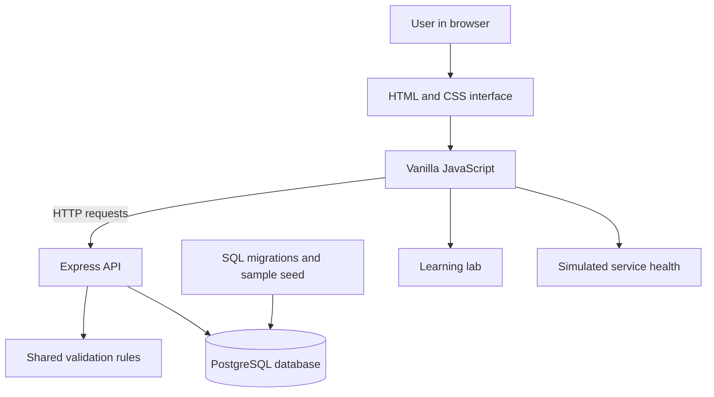

# StreamOps — Streaming Engineering Console

StreamOps is an independent full-stack portfolio project inspired by internal tools used to manage content records, track incidents, and learn service reliability concepts.

> **Learning/demo project:** titles and incidents are fictional. Availability, latency, error rates, charts, and dashboard trends are illustrative values—not live telemetry from a real streaming platform.

## Features

- Content catalogue: list, search, filter, and add fictional titles.
- Incident tracker: search/filter incidents, create incidents, and move them through Open → Investigating → Resolved.
- PostgreSQL persistence through a standalone Node.js API.
- Service-health dashboard with clearly labelled simulated metrics.
- Learning lab with explanations, diagrams, code examples, and quick checks.
- Shared validation rules and automated unit tests.

## Technology

- HTML, CSS, and vanilla JavaScript
- Node.js and Express
- PostgreSQL and the `pg` database driver
- Node.js built-in test runner
- Hatchable remains an optional hosted version; the repository now also contains a conventional local server.

## Architecture



The browser sends HTTP requests to Express. The server validates submitted data, runs parameterized SQL queries, and returns JSON. PostgreSQL stores titles and incidents. The service-health panel is educational sample content and does not monitor a production system.

## Project structure

```text
streamops/
├── public/
│   ├── index.html
│   ├── styles.css
│   └── app.js
├── api/                         # Hatchable-hosted API handlers
├── lib/
│   └── validation.js            # Shared validation logic
├── scripts/
│   ├── migrate.js               # Applies each SQL migration once
│   └── seed.js                  # Seeds only an empty demo database
├── migrations/
│   ├── 001_titles.sql
│   └── 002_incidents.sql
├── tests/
│   └── validation.test.mjs
├── server.js                    # Standalone Express + PostgreSQL API
├── package.json
├── .env.example
├── seed.sql
└── README.md
```

## Run locally (Windows)

### 1. Install prerequisites

Install **Node.js 20 or newer** and **PostgreSQL 13 or newer**. During PostgreSQL setup, remember the password you set for the `postgres` database user. You can use pgAdmin, which is included with many PostgreSQL installers, to create and manage the local database.

### 2. Create the database

Open pgAdmin, connect to your local PostgreSQL server, open the Query Tool, and run:

```sql
CREATE DATABASE streamops;
```

If a database named `streamops` already exists, do not create it again.

### 3. Configure the connection

From the repository root in PowerShell, run:

```powershell
Copy-Item .env.example .env
```

Open the new `.env` file and replace `your_password` in `DATABASE_URL` with the password for your local PostgreSQL user. Keep `.env` private; it is ignored by Git. If your password contains URL-special characters, URL-encode those characters in the connection URL.

### 4. Install dependencies and prepare the database

Run these commands from the project folder:

```powershell
npm install
npm run db:migrate
npm run db:seed
```

The migration command creates the tables and records which migrations have already run, so rerunning it will not reapply them. The seed command adds fictional starter records only when both tables are empty; it stops rather than risking duplicate sample data.

### 5. Start StreamOps

```powershell
npm start
```

Open [http://localhost:3000](http://localhost:3000). To check the backend and database connection, open [http://localhost:3000/api/health](http://localhost:3000/api/health); a healthy response looks like:

```json
{"status":"ok","database":"connected"}
```

Keep the terminal running while using the app. Press `Ctrl+C` in that terminal to stop the server. For development with automatic server restarts, use `npm run dev`.

### Troubleshooting

- **Database connection refused:** make sure the PostgreSQL service is running and the port/user/password in `.env` are correct.
- **Password authentication failed:** check the password for the PostgreSQL user and update `DATABASE_URL`.
- **Relation does not exist:** run `npm run db:migrate`.
- **Port 3000 is in use:** change `PORT=3000` in `.env` to another free port, then restart the server.

## API overview

All standalone API routes are prefixed with `/api`.

| Method | Route | Purpose |
|---|---|---|
| GET | `/api/health` | Check the API and database connection |
| GET | `/api/titles` | List catalogue titles |
| POST | `/api/titles` | Validate and create a title |
| GET | `/api/incidents` | List incidents, prioritizing unresolved/high-severity records |
| POST | `/api/incidents` | Validate and create an incident |
| PUT | `/api/incidents/:id` | Update an incident status |

The API validates required fields and allowed values. Database writes use parameterized queries. The incident update endpoint returns 404 if the requested incident does not exist, and unexpected server errors return a generic response while details are logged in the terminal.

## Automated tests

### Unit tests

The nine tests in `tests/validation.test.mjs` test shared validation logic: valid inputs, defaults, whitespace trimming, missing required fields, unsupported values, length limits, and incident status updates.

Run them with:

```powershell
npm test
```

These are **unit tests**, not API/database integration tests. Earlier live API checks were performed separately. A repeatable integration-test suite that exercises HTTP requests and PostgreSQL against the standalone server is still a planned next testing improvement.

## Hosted Hatchable version

The project also retains the original `api/` handlers for the Hatchable-hosted version. Those files import the platform-provided `db` client from `hatchable` and are not intended to run directly in a generic Node.js server. The standalone `server.js` uses Express and the standard PostgreSQL driver instead. Both versions share `lib/validation.js`.

The Hatchable project is available at [the StreamOps console](https://hatchable.com/console/projects/streamops-streaming-y8c2). Its visibility and access settings are controlled separately from this public GitHub repository.

## Learning roadmap

- [x] Add shared validation functions and repeatable unit tests.
- [x] Add a conventional Node.js/Express backend and PostgreSQL connection.
- [x] Add a migration runner and guarded demo seed script.
- [ ] Add repeatable API/database integration tests.
- [ ] Add pagination and stronger search/filter behavior.
- [ ] Check accessibility and keyboard interactions.
- [ ] Add current screenshots of the working interface.
- [ ] Polish the portfolio presentation and explain the design decisions.

## Why I built it

This project helps me learn how frontend screens, REST-style API routes, validation, SQL persistence, and operational workflows fit together. It is inspired by streaming-platform engineering concepts, but it is an independent educational project and is not affiliated with or endorsed by Netflix or another streaming company.
