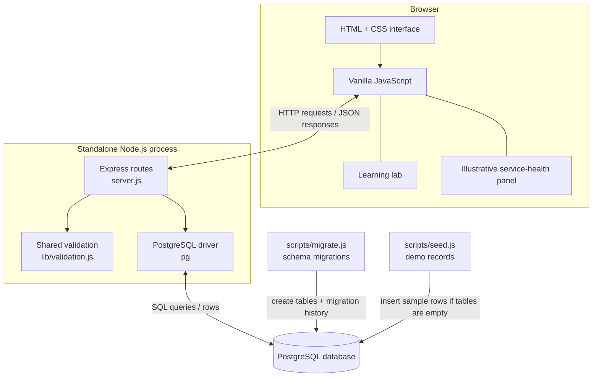

# StreamOps Architecture

This document describes the standalone local version of StreamOps. The separate Hatchable handlers under `api/` are retained for the hosted implementation.

## Component diagram

## Main responsibilities

| Component | Responsibility |
|---|---|
| `public/index.html`, `styles.css` | Page structure and visual presentation |
| `public/app.js` | Navigation, rendering, forms, and HTTP requests |
| `server.js` | Express app, API endpoints, database access, and error handling |
| `lib/validation.js` | Shared, testable validation rules |
| `migrations/*.sql` | Database schema definitions |
| `scripts/migrate.js` | Applies each migration once and tracks it |
| `scripts/seed.js`, `seed.sql` | Adds fictional starter data to an empty application database |
| `tests/validation.test.mjs` | Unit tests for validation behavior |
| `api/*.js` | Separate Hatchable-hosted route handlers |

## Example request: create a title

1. A user submits the **Add title** form.
2. The browser JavaScript sends a JSON `POST /api/titles` request.
3. Express receives the request and calls the shared validation rules.
4. If the payload is valid, the server runs a parameterized SQL insert through `pg`.
5. PostgreSQL stores the row and the API returns the created record.
6. The frontend refreshes the catalogue from the API, so the saved title appears after a browser refresh too.

If validation fails, the API returns a client error rather than writing the invalid record. Database errors are logged server-side; clients receive a generic error response.

## Data and scope boundaries

- PostgreSQL is the source of truth for catalogue and incident records in the standalone app.
- The service-health cards, charts, and trend values are static illustrative demo data. They do not come from monitoring, analytics, or a real streaming service.
- The learning lab is client-side educational content.
- The nine automated tests are unit tests for validation. A repeatable integration suite that starts the API and exercises real HTTP/database behavior is still planned.
